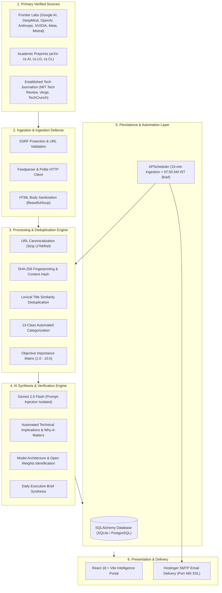

# AI Intelligence Radar

<div align="center">


**Automated Multi-Source AI News Aggregation &bull; Noise-Free Deduplication &bull; Gemini Intelligence Synthesis &bull; 07:00 AM IST Automated Briefing Delivery**

[Live Demo](http://127.0.0.1:5173) &bull; [API Documentation](http://127.0.0.1:8000/docs) &bull; [Deployment Guide](#7-production-deployment) &bull; [Bug Reports](https://github.com/Manindra-babu/AI_Deck/issues)

</div>

---

## 1. Executive Summary & Problem Statement

Artificial Intelligence developments are moving at unprecedented velocity, scattered across hundreds of research labs, academic archives, corporate blogs, and social platforms. Engineers, researchers, and decision-makers face severe challenges:

- **Information Saturation**: Excessive coverage repeating the same announcements across multiple publications.
- **Hype vs. Fact**: Marketing claims presented as independent scientific breakthroughs.
- **Buried Breakthroughs**: Foundational model releases and architectural papers lost in general tech news.
- **Manual Overhead**: Inefficient daily monitoring of dozens of discrete platforms.

**AI Intelligence Radar** is an enterprise-grade intelligence platform that continuously polls verified RSS/Atom feeds across primary frontier laboratories and arXiv preprints. It cleans, hashes, and deduplicates coverage, scores items using an objective importance matrix, synthesizes daily executive intelligence reports via **Gemini 2.5 Flash**, and dispatches automated HTML reports to your inbox every morning at **07:00 AM IST** via **Hostinger SMTP**.

---

## 2. System Architecture



---

## 3. Core Features & Capabilities

### 📡 Real-Time Intelligence Dashboard
- **Live Metrics**: Real-time counter of deduplicated articles, active monitored sources, tracked foundation models, and arXiv papers.
- **Breaking & High-Impact Section**: Surface developments with importance $\ge 7.0$ with explicit justification and verification status.
- **Direct Primary Links**: Click-through to primary documentation and original announcements.
- **Manual Ingestion Trigger**: Synchronize incoming feeds on demand.

### 📝 AI Intelligence Brief (07:00 AM IST)
- **Executive Synthesis**: Concise overview of top industry movements, architectural breakthroughs, and corporate strategy.
- **Top Developments**: Ranked items detailing *What Happened*, *Why It Matters*, and *Technical Implications*.
- **Multi-Source Credibility Tiers**:
  - `Confirmed announcement`: Official lab/company releases.
  - `Research finding`: Peer-reviewed or arXiv papers.
  - `Company claim`: Marketing assertions requiring independent verification.
  - `Reported development`: Investigative journalism.
  - `Unverified claim`: Rumors and leaks.

### 🧭 News Explorer & Duplicate Detector
- **Semantic Search**: Instant full-text search across titles, contents, and AI summaries.
- **Granular Filters**: Filter by 13 categories, source tier, verification status, and importance thresholds.
- **Duplicate Coverage Grouping**: Identifies when multiple outlets cover the same announcement and groups them into a unified story thread.
- **Reading List & Bookmarks**: Save articles and mark items as read.

### 🤖 AI Models Tracker
- **Model Release Registry**: Tracks new model announcements, parameters, benchmarks, and architectural paradigms.
- **Open Weights Verification**: Distinct badges indicating open-source weights vs. proprietary API-only access.

### 🎓 Research Radar (arXiv Integration)
- **arXiv Synchronization**: Continuous polling of `cs.AI`, `cs.LG`, and `cs.CL`.
- **Practitioner Breakdown**: AI-generated technical summaries and research significance explanations tailored for engineers.

### ⚙️ Source Management & Feed Prober
- **Feed Diagnostics**: Live latency, HTTP status, entry counts, and error tracking per source.
- **Real-Time URL Validator**: Tests any RSS/Atom endpoint before adding.
- **Automated Source Discovery**: Probes AI research lab domains and verifies feed autodiscovery.

---

## 4. Design Philosophy & Color Palette

The interface is engineered to prioritize **information density, legibility, and research professionalism**:

| Element | Color Hex | Sample | Description |
|---|---|---|---|
| **Background** | `#F7F9FC` | `Light Neutral` | Soft slate background reducing glare |
| **Surface** | `#FFFFFF` | `Pure White` | Card and modal surfaces |
| **Primary Text** | `#172033` | `Graphite Navy` | High-contrast readable typography |
| **Secondary Text** | `#64748B` | `Slate Gray` | Metadata, timestamps, and subtitles |
| **Primary Accent** | `#2563EB` | `Engineering Blue` | Badges, active tabs, and primary actions |
| **Borders** | `#E5EAF1` | `Subtle Gray` | Clean structural dividing borders |
| **Success** | `#15803D` | `Forest Green` | Verified and healthy indicators |
| **Warning** | `#B45309` | `Amber` | Company claims and notable developments |
| **Critical** | `#B91C1C` | `Deep Red` | High-importance breakthroughs & errors |

> [!NOTE]
> **Strict Anti-Hallucination & Aesthetic Guarantee**: The UI prohibits purple gradients, neon cards, fake counters, AI-generated thumbnails, and artificial engagement metrics. If no verified articles exist in a filter, an honest empty state is shown.

---

## 5. Technology Stack

### Backend
- **Framework**: FastAPI (Python 3.11+)
- **Validation**: Pydantic v2 & Pydantic-Settings
- **ORM / Database**: SQLAlchemy 2.0 (SQLite for local zero-config, PostgreSQL for production)
- **Ingestion**: `feedparser`, `httpx` (async HTTP), `beautifulsoup4`
- **Scheduler**: `APScheduler` (cron + interval triggers)
- **AI Engine**: `google-genai` SDK with `gemini-2.5-flash`
- **Email Delivery**: Python `smtplib` (Hostinger SSL port 465)
- **Testing**: `pytest` & `pytest-asyncio`

### Frontend
- **Framework**: React 18 with TypeScript
- **Tooling**: Vite 5
- **Styling**: Tailwind CSS with custom research-palette extensions
- **Icons**: Lucide React
- **Architecture**: SPA with proxying to backend `/api/`

---

## 6. Local Development Setup

### Prerequisites
- Python 3.11 or 3.13
- Node.js 18+ and npm
- Git

### Step 1: Clone the Repository
```bash
git clone https://github.com/Manindra-babu/AI_Deck.git
cd AI_Deck
```

### Step 2: Configure Environment Variables
Copy the template `.env.example` to `backend/.env`:
```bash
cp .env.example backend/.env
```

Edit `backend/.env`:
```ini
DATABASE_URL=sqlite:///./ai_radar.db
GEMINI_API_KEY=your_gemini_api_key_here
GEMINI_MODEL=gemini-2.5-flash

# Hostinger SMTP (Optional for local testing)
SMTP_HOST=smtp.hostinger.com
SMTP_PORT=465
SMTP_USERNAME=news@yourdomain.com
SMTP_PASSWORD=your_mailbox_password
SMTP_USE_SSL=true
EMAIL_RECIPIENT=your_email@domain.com

TIMEZONE=Asia/Kolkata
NEWS_COLLECTION_INTERVAL_MINUTES=15
DAILY_REPORT_HOUR=7
DAILY_REPORT_MINUTE=0
```

### Step 3: Run with Startup Script (Windows)
```powershell
# Double-click or run:
.\start.bat
# Or via PowerShell:
.\start.ps1
```

### Step 4: Manual Startup (Cross-Platform)

**Terminal 1 — Backend:**
```bash
cd backend
python -m venv venv

# Windows
.\venv\Scripts\activate
# Linux/macOS
source venv/bin/activate

pip install -r requirements.txt
python run.py
```

**Terminal 2 — Frontend:**
```bash
cd frontend
npm install
npm run dev
```

Visit **[http://localhost:5173](http://localhost:5173)**.

---

## 7. Production Deployment

### Option A: Docker Compose (Recommended)

The repository includes production-ready Docker configurations for both services:

```bash
# 1. Provide your environment variables
cp .env.example .env

# 2. Build and start containers in detached mode
docker compose up -d --build

# 3. Verify container health
docker compose ps
docker compose logs -f
```

- **Frontend**: Available at `http://localhost` (or Port 80).
- **Backend API**: Reverse-proxied via Nginx or directly at `http://localhost:8000`.
- **Database**: Persisted in Docker volume `ai_radar_storage`.

---

### Option B: Cloud Deployment (Render.com / Railway)

The repository contains `render.yaml` for 1-click infrastructure orchestration:

1. Link your GitHub repository `Manindra-babu/AI_Deck` to [Render](https://render.com).
2. Render automatically detects `render.yaml`:
   - Deploys **Backend Web Service** running `uvicorn app.main:app`.
   - Deploys **Frontend Static Site** running `npm run build`.
3. Fill in secret environment variables (`GEMINI_API_KEY`, `SMTP_USERNAME`, `SMTP_PASSWORD`).

---

### Option C: Ubuntu / Debian VPS Deployment (Systemd + Nginx)

#### 1. Backend Service (`/etc/systemd/system/ai-radar.service`)
```ini
[Unit]
Description=AI Intelligence Radar API Engine
After=network.target

[Service]
User=ubuntu
WorkingDirectory=/var/www/AI_Deck/backend
Environment="PATH=/var/www/AI_Deck/backend/venv/bin"
ExecStart=/var/www/AI_Deck/backend/venv/bin/uvicorn app.main:app --host 127.0.0.1 --port 8000
Restart=always

[Install]
WantedBy=multi-user.target
```

```bash
sudo systemctl daemon-reload
sudo systemctl enable --now ai-radar
```

#### 2. Nginx Reverse Proxy (`/etc/nginx/sites-available/ai-radar`)
```nginx
server {
    listen 80;
    server_name your-radar-domain.com;

    # Frontend Static Distribution
    location / {
        root /var/www/AI_Deck/frontend/dist;
        try_files $uri $uri/ /index.html;
    }

    # Backend API Proxy
    location /api/ {
        proxy_pass http://127.0.0.1:8000/api/;
        proxy_set_header Host $host;
        proxy_set_header X-Real-IP $remote_addr;
        proxy_set_header X-Forwarded-For $proxy_add_x_forwarded_for;
        proxy_set_header X-Forwarded-Proto $scheme;
    }
}
```

```bash
sudo ln -s /etc/nginx/sites-available/ai-radar /etc/nginx/sites-enabled/
sudo nginx -t && sudo systemctl reload nginx
```

---

## 8. Hostinger SMTP & Email Configuration

AI Intelligence Radar sends automated reports formatted in clean, responsive HTML using your Hostinger business email:

1. Log into your **Hostinger hPanel** &rarr; **Emails** &rarr; select domain.
2. Note your configuration:
   - **SMTP Host**: `smtp.hostinger.com`
   - **SMTP Port**: `465` (SSL) or `587` (TLS)
   - **SMTP Username**: your full mailbox address (e.g., `briefing@yourdomain.com`)
   - **SMTP Password**: mailbox password
3. Test your credentials directly from the UI under the **Settings** tab via **"Test SMTP Credentials"**.

> [!TIP]
> The scheduler strictly checks whether today's report has already been delivered to avoid sending duplicate emails.

---

## 9. API Reference

| Method | Endpoint | Description |
|---|---|---|
| `GET` | `/api/health` | Diagnostic status of API, DB, and collection |
| `GET` | `/api/dashboard/summary` | Real metrics, breaking developments, latest news, and categories |
| `GET` | `/api/articles` | Query verified articles with search, filters, and pagination |
| `GET` | `/api/articles/{id}` | Deep inspection, AI implications, and duplicate coverage detection |
| `PATCH` | `/api/articles/{id}/read` | Toggle read status |
| `PATCH` | `/api/articles/{id}/bookmark` | Toggle bookmark status |
| `GET` | `/api/reports/latest` | Retrieve today's Daily Intelligence Brief |
| `POST` | `/api/reports/generate` | Trigger manual synthesis of daily report |
| `POST` | `/api/reports/{id}/send-email` | Dispatch daily brief to configured recipient via SMTP |
| `GET` | `/api/models` | List confirmed AI foundation models |
| `GET` | `/api/research` | Query arXiv research papers and AI explanations |
| `GET` | `/api/sources` | Monitor configured RSS sources and discovered candidate feeds |
| `POST` | `/api/sources` | Add new validated RSS feed |
| `POST` | `/api/sources/test` | Test RSS endpoint connectivity before adding |
| `POST` | `/api/sources/discover` | Run crawler to identify feeds for candidate AI entities |
| `GET` | `/api/settings` | Read current system settings (secrets masked) |
| `POST` | `/api/settings` | Update Gemini keys, SMTP credentials, or schedule |
| `POST` | `/api/settings/test-smtp` | Test SMTP server connection and credentials |
| `POST` | `/api/settings/trigger-collection` | Trigger an immediate news ingestion cycle |

---

## 10. Verification & Test Suite

The platform includes full automated test coverage using `pytest`:

```powershell
# Set PYTHONPATH and run test suite
$env:PYTHONPATH="backend"
.\backend\venv\Scripts\pytest backend\tests -v
```

### Verified Test Cases:
- `test_processor.py`:
  - URL normalization (stripping tracking query tags).
  - Deterministic SHA-256 fingerprinting.
  - Lexical sequence similarity (`difflib.SequenceMatcher`).
  - Automated 13-class category assignment.
  - Objective importance calculation ($1.0 - 10.0$) and reasons.
  - Verification status classification.
- `test_email.py`:
  - HTML email rendering.
  - Responsive email structure.
  - Color palette verification (zero purple hex codes).
- `test_api.py`:
  - Health checks, dashboard metrics, articles query, model tracker, research papers, sources, and settings endpoints.

---

## 11. Contributing & License

Contributions, issues, and feature requests are welcome!

1. Fork the Project
2. Create your Feature Branch (`git checkout -b feature/NewFeature`)
3. Commit your Changes (`git commit -m 'Add new feature'`)
4. Push to the Branch (`git push origin feature/NewFeature`)
5. Open a Pull Request

Distributed under the **MIT License**. See `LICENSE` for more information.

---

<div align="center">
Built with precision for AI engineers and researchers. Never miss important AI breakthroughs.
</div>
